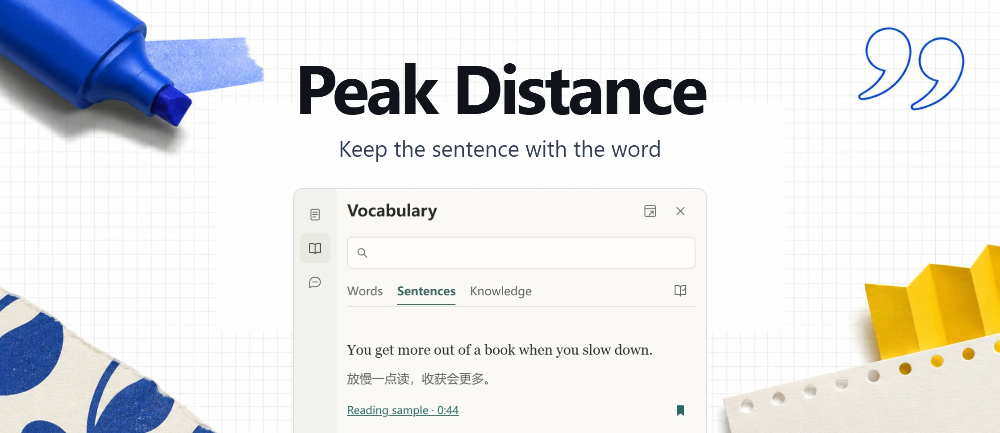
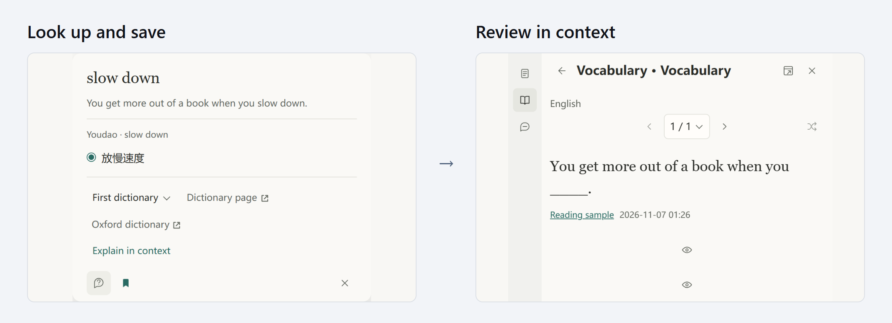

<h1 align="center">Peak Distance</h1>

  
  
  
  

<a href="https://github.com/Kylan3320/peak-distance/releases/latest">Download</a> · <a href="#quick-start">Quick start</a> · <a href="#docs">Docs</a> · <a href="README.md">简体中文</a>

I built Peak Distance for my own language learning. When I run into an expression on a webpage, on X, or on YouTube, I can save it with its original sentence and source. Next time I open my vocabulary list, I can pick up from that sentence.

## From lookup to review

Select **slow down** on a webpage, look it up, and hit the bookmark. Choose **Review in context** in your vocabulary list and try to recall the expression in the same sentence.

On YouTube, you can also read bilingual captions, save a whole sentence, and replay it. The vocabulary list keeps your languages together, with filters for language and search for original sentences and translations.

## Quick start

The current release is [v0.72.0](https://github.com/Kylan3320/peak-distance/releases/tag/v0.72.0). Desktop Chrome requires version 142 or newer.

1. Download and extract the `-chrome.zip` from the [latest release](https://github.com/Kylan3320/peak-distance/releases/latest).
2. Open `chrome://extensions` (or `edge://extensions` in Edge) and turn on **Developer mode**.
3. Choose **Load unpacked**, then select the folder that contains `manifest.json`.

Refresh a webpage and select a word to try it. To update, extract the new files into the original install folder and click **Reload** on the extensions page.

## Where your notes live

Records stay in your browser by default. To work with them in Obsidian, connect a local folder under **Settings → Shared files**. Words, sentences, and notes can be written to Markdown. Chrome and Edge on the same computer can use the same folder. [Learning vault docs](docs/specs/vault-collections-sync.md)

AI chat and online services

Regular lookups and translations work without an API key. To ask questions about a passage, set up your own provider and key under **Settings → AI services**. Online lookups and translations send the text needed for the query to the chosen service. AI chat sends your question and the material you attach. The key stays in the current browser.

## Docs

| Where | What you'll find |
| --- | --- |
| [Product](docs/PRD.md) | Features and supported use cases |
| [Development](docs/ARCHITECTURE.md) | Code entry points and modules |
| [Roadmap](docs/ROADMAP.md) | Progress, known issues, and releases |

Build from source

With Node.js 22.12 or newer, run `npm ci` and `npm run build`. Load `.output/build/chrome-mv3` in a separate browser profile.

[MIT](LICENSE)
