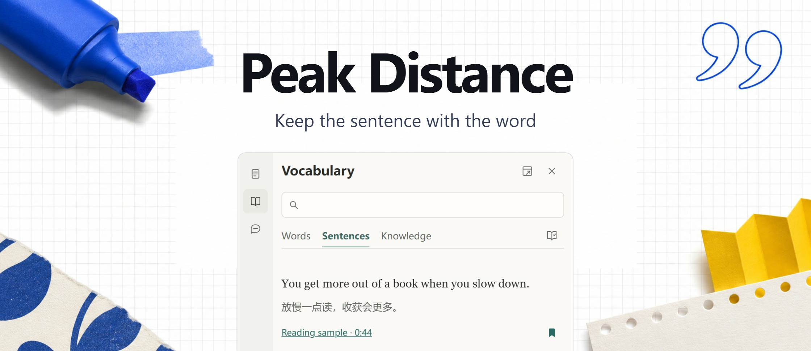
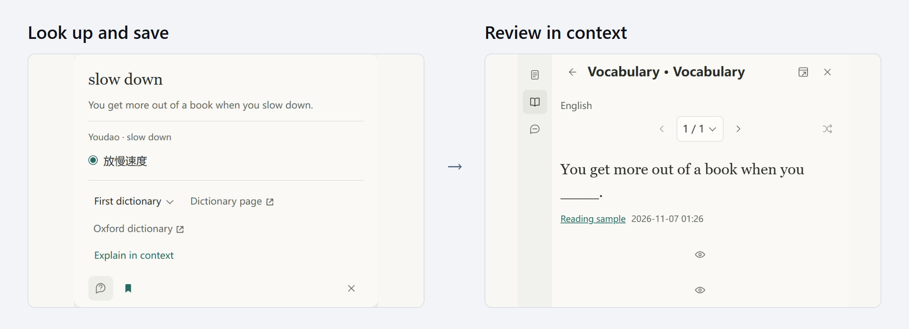

<h1 align="center">Peak Distance</h1>

  
  
  
  

<a href="https://github.com/Kylan3320/peak-distance/releases/latest">Download</a> · <a href="#quick-start">Quick start</a> · <a href="#docs">Docs</a> · <a href="README.md">简体中文</a>

Peak Distance is a browser extension for looking up and reviewing words and phrases as you browse the web, read posts on X, or watch YouTube. When you save an expression, the extension keeps the original sentence and a link back to the page, post, or spot in the video where you found it. Open **Current content** to review what you’ve saved from the page or video you’re on.

## From lookup to review

Select **slow down** on a webpage, look it up, and click the bookmark icon to save it. Open your vocabulary list and choose **Review in context** to do a fill-in-the-blank exercise with the original sentence.

On YouTube, you can also read bilingual captions, save a whole sentence, and replay it. The vocabulary list keeps your languages together, with filters for language and search for original sentences and translations.

## Quick start

Desktop Chrome requires version 142 or newer.

1. Download and extract the `-chrome.zip` from the [latest release](https://github.com/Kylan3320/peak-distance/releases/latest).
2. Open `chrome://extensions` (or `edge://extensions` in Edge) and turn on **Developer mode**.
3. Choose **Load unpacked**, then select the folder that contains `manifest.json`.

Refresh a webpage and select a word to try it. To update, extract the new package into an empty folder and replace the files at the original installation path. Click **Reload** on the extensions page, then refresh webpages.

## Where your records are stored

Your learning records stay in your browser by default. To save them as files, choose a local folder under **Settings → Shared files**. Peak Distance saves your words, sentences, and notes as Markdown files you can open in Obsidian. If you use Chrome and Edge on the same computer, connect both browsers to the same folder to share your records. [Learning vault docs](docs/specs/vault-collections-sync.md)

AI chat and online services

Regular lookups and translations work without an API key. To ask questions about a passage, set up your own provider and key under **Settings → AI services**. Online lookups and translations send the text needed for the query to the chosen service. AI chat sends your question and the material you attach. The key stays in the current browser.

## Docs

| Where | What you'll find |
| --- | --- |
| [Product](docs/PRD.md) | Features and supported use cases |
| [Issue tracker](https://github.com/Kylan3320/peak-distance/issues) | Report a problem or see existing reports |
| [Development guide (Chinese)](docs/DEVELOPMENT.md) | Build from source, run checks, and prepare a release |

[MIT](LICENSE)
