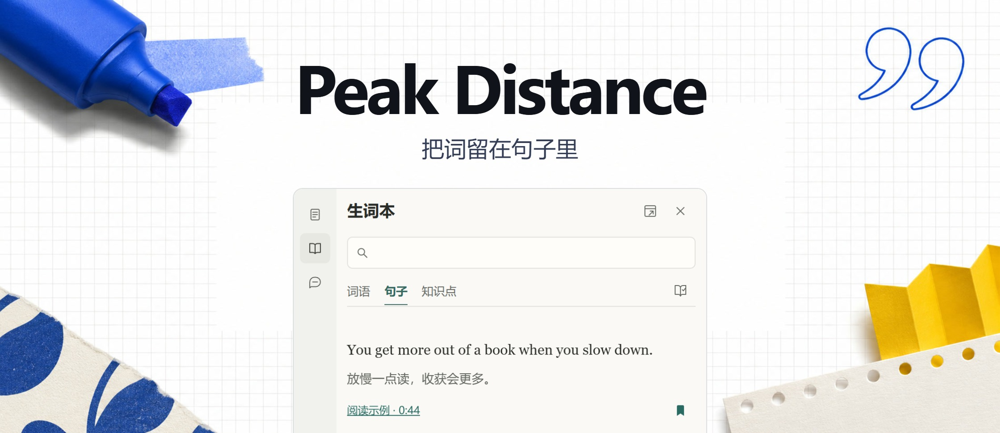
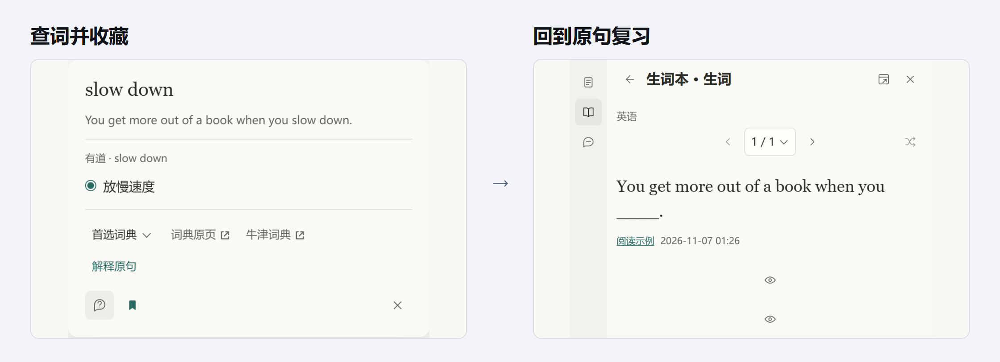

<h1 align="center">Peak Distance</h1>

  
  
  
  

<a href="https://github.com/Kylan3320/peak-distance/releases/latest">下载安装包</a> · <a href="#快速开始">快速开始</a> · <a href="#文档">文档</a> · <a href="README.en.md">English</a>

Peak Distance 是我做给自己用的浏览器扩展。读网页、刷 X 或看 YouTube 时，遇到想记住的表达，可以连同原句和来源一起收藏。下次翻生词本，还能从那句话接着学。

## 从查词到复习

在网页上选中 **slow down**，查一下意思，再点书签。回到生词本打开原句复习，那句话还在，挖空的地方留给自己想。

看 YouTube 时，也可以开双语字幕、收藏整句或按句回听。不同语言的记录放在同一个生词本里，可以按语言筛选，也能搜原句和译文。

## 快速开始

当前发布版为 [v0.72.3](https://github.com/Kylan3320/peak-distance/releases/tag/v0.72.3)。桌面 Chrome 需要 142 或更新版本。

1. 下载并解压 [最新 Release](https://github.com/Kylan3320/peak-distance/releases/latest) 里的 `-chrome.zip`。
2. 打开 `chrome://extensions`（Edge 用 `edge://extensions`），开启「开发者模式」。
3. 点「加载已解压的扩展程序」，选择包含 `manifest.json` 的文件夹。

装好后刷新网页，选中一个词试试。以后升级，把新版解压到原安装目录，再在扩展页点「重新加载」。

## 记录存在哪里

默认存在当前浏览器。想用 Obsidian 整理，可以在「设置 → 文件共享」连接本地目录，把词语、句子和笔记写成 Markdown。同一台电脑上的 Chrome 和 Edge 可以连接同一个目录。[学习库文档](docs/specs/vault-collections-sync.md)

AI 问答和在线服务

常规查词和翻译无需 API Key。想带着原文提问，可以在「设置 → AI 服务」配置自己的服务和 Key。在线查询会把所需文本发给对应服务，AI 问答会发送问题和附上的材料。Key 保存在当前浏览器。

## 文档

| 入口 | 内容 |
| --- | --- |
| [产品说明](docs/PRD.md) | 功能和支持范围 |
| [开发](docs/ARCHITECTURE.md) | 代码入口和模块 |
| [路线图](docs/ROADMAP.md) | 进展、已知问题和发布流程 |

从源码构建

用 Node.js 22.12 或更新版本运行 `npm ci` 和 `npm run build`，再在独立浏览器配置中加载 `.output/build/chrome-mv3`。

## 开发检查

按改动选择验证：文档只核对事实与受影响引用；逻辑修复运行对应复现及相邻回归；界面和浏览器行为使用当前构建检查受影响操作，涉及浏览器差异时再检查 Chrome／Edge。已有结果对应同一提交和产物时复用，不默认全量重跑或校验哈希。

`verify-local` 是发布检查入口，不负责构建；先 `npm run zip`，再按 ROADMAP 指向解包后的待发布产物。定向脚本见相关规格，历史报告中的命令不是每次必跑清单。`e2e-check` 是依赖本机环境的历史实机入口，可能使用 `BLC_SETTINGS_PATH` 中的 Key 发出真实 AI 请求；不作为日常离线检查。

[MIT](LICENSE)
