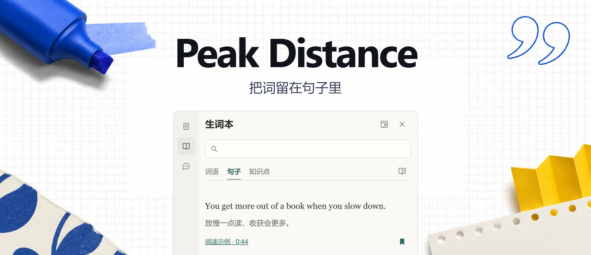
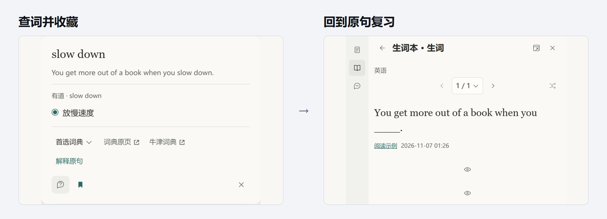

<h1 align="center">Peak Distance</h1>

  
  
  
  

<a href="https://github.com/Kylan3320/peak-distance/releases/latest">下载安装包</a> · <a href="#快速开始">快速开始</a> · <a href="#文档">文档</a> · <a href="README.en.md">English</a>

Peak Distance 是一个用来查词和复习的浏览器扩展。读网页、刷 X 或看 YouTube 时，遇到不懂的词或短语，可以查意思并收藏，原句和来源也会一起保存。之后可以从收藏记录回到原网页或帖子，也可以跳到视频里对应的位置。「当前内容」会把同一篇文章或同一个视频里的收藏放在一起，方便集中复习。

## 从查词到复习

在网页上选中 **slow down**，查完词后点词卡上的书签收藏。之后可以在生词本里打开「原句复习」，用收藏的句子做填空练习。

看 YouTube 时，也可以开双语字幕、收藏整句或按句回听。不同语言的记录放在同一个生词本里，可以按语言筛选，也能搜原句和译文。

## 快速开始

桌面 Chrome 需要 142 或更新版本。

1. 下载并解压 [最新 Release](https://github.com/Kylan3320/peak-distance/releases/latest) 里的 `-chrome.zip`。
2. 打开 `chrome://extensions`（Edge 用 `edge://extensions`），开启「开发者模式」。
3. 点「加载已解压的扩展程序」，选择包含 `manifest.json` 的文件夹。

安装后刷新网页，选中一个词，再点击「查词」试试。

升级时，先把新版解压到一个空文件夹，再用新版文件替换原安装目录里的整套扩展文件，保留原来的安装路径。替换完成后，到扩展管理页点击「重新加载」，再刷新网页。

## 记录存在哪里

学习记录默认保存在当前浏览器里。你也可以在「设置 → 文件共享」里选一个本地文件夹，让扩展把词语、句子和笔记存成 Markdown 文件，方便用 Obsidian 整理。同一台电脑上的 Chrome 和 Edge 可以连接同一个文件夹，共用这些记录。[学习库文档](docs/specs/vault-collections-sync.md)

AI 问答和在线服务

常规查词和翻译无需 API Key。想带着原文提问，可以在「设置 → AI 服务」配置自己的服务和 Key。在线查询会把所需文本发给对应服务，AI 问答会发送问题和附上的材料。Key 保存在当前浏览器。

## 文档

| 入口 | 内容 |
| --- | --- |
| [产品说明](docs/PRD.md) | 功能和支持范围 |
| [反馈问题](https://github.com/Kylan3320/peak-distance/issues) | 报告问题或查看已有反馈 |
| [开发指南](docs/DEVELOPMENT.md) | 从源码构建、验证和发布 |

## 许可证

Peak Distance 的原创部分采用 [PolyForm Noncommercial 1.0.0](LICENSE)，这项许可也适用于所有已发布的历史版本。此前已授出的 MIT 许可继续有效。第三方组件适用[各自的许可证](public/THIRD_PARTY_NOTICES.txt)。

如需取得 PolyForm 许可范围以外的商业授权，请通过我的[个人网站](https://lowoo.com.de/)与我联系。
